# Supply Chain Data Catalogue & Governance with OpenMetadata

[](https://github.com/cesarrb/openmetadata-supply-chain-governance/actions/workflows/ci.yml)

A hands-on, reproducible data-governance setup for a manufacturing supply chain running on an
SAP-style ERP: **metadata ingestion, column-level lineage from ERP to BI dashboard, PII classification
with steward review, business glossary, data-quality tests, data contracts, access policies and a
measured governance scorecard**, built on [OpenMetadata](https://open-metadata.org) 2.0.7, dbt and
Metabase, all kept as code and checked in CI.

**Live demo (no install needed):** [dbt docs with models, columns, tests and the lineage graph](https://cesarrb.github.io/openmetadata-supply-chain-governance/),
rebuilt by CI on every push. Click the lineage icon (bottom right) on any model, e.g. `fct_otif`.
The full OpenMetadata catalogue runs locally with Docker (see [Run it](#run-it)) and is shown in the
[screenshots](#screenshots).

> All data is synthetic (fixed random seed). Table names follow SAP ECC conventions
> (MARA, MARC, LFA1, KNA1, EKKO/EKPO, VBAK/VBAP, LIKP/LIPS, MARD) so the catalogue looks like
> a real ERP landscape.

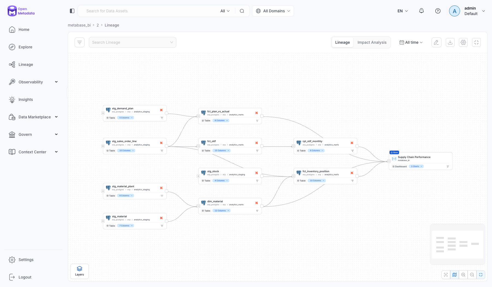
*Lineage of the Metabase "Supply Chain Performance" dashboard: dbt staging models (left) → certified KPI
marts → dashboard (right). OpenMetadata derives it from dbt and from each chart's SQL; nothing is drawn by hand.*

## What it demonstrates

| Capability | How it is done here | Result |
|---|---|---|
| **Metadata ingestion** | OpenMetadata connectors for Postgres, dbt and Metabase | 26 tables, 3 charts and 1 dashboard, described from SAP comments and dbt docs |
| **Lineage** | View SQL + dbt manifest + Metabase question SQL | ERP table → staging → mart → dashboard chart; 41 table edges, 182 column-level mappings |
| **Classification** | Auto-classification + steward review in YAML | 5 personal-data columns tagged; 1 missed column added and 4 false positives rejected by the steward |
| **Business glossary** | 13 approved terms (OTIF, Plan vs Actual, Days of Inventory, Safety Stock…) | Terms linked to the exact column that computes each KPI |
| **Data quality** | OpenMetadata test runner (raw layer) + dbt tests (transformations) | 31 tests: 25 pass, and the 6 failures are exactly the 3 defects injected on purpose, caught at both layers; each failure opens an incident |
| **Data contracts** | Schema, semantics, quality, SLA and security per certified table; exported as ODCS | 4 contracts, 4 passing validation |
| **Access control** | One policy: Restricted data rows visible only to the owner team | Verified per persona with OpenMetadata's permission API |
| **Ownership & trust** | 4 teams, 3 domains, 1 data product, Tier, Gold certification | 17 governed tables, 4 certified |
| **Governance KPIs** | `scripts/scorecard.py` measures adoption from the API | [docs/SCORECARD.md](docs/SCORECARD.md) |
| **CI** | GitHub Actions on every pull request | Rebuilds the warehouse, gates on test results, validates governance references |
| **Operating model** | [docs/GOVERNANCE_MODEL.md](docs/GOVERNANCE_MODEL.md) | RACI, classification policy, certification and contracts, access, domain onboarding |

## Architecture

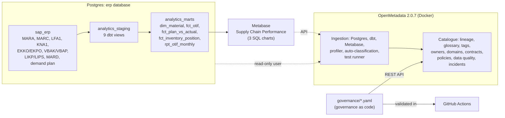

## Repository layout

```
data/          synthetic SAP-style data generator (3 deliberate defects) + database init
dbt/           staging and mart models (OTIF, Plan vs Actual, inventory) with tests
ingestion/     OpenMetadata workflows: Postgres, dbt, profiler, auto-classification, Metabase
governance/    governance.yaml   teams, domains, glossary, tags, owners, certification, policies
               data_quality.yaml quality contract with a business rationale per test
               contracts.yaml    data contracts for the certified tables
contracts/     data contracts exported in the Open Data Contract Standard (ODCS)
scripts/       apply_governance, data_quality, apply_contracts, scorecard, check_access,
               setup_metabase, validate_governance, check_dbt_results, screenshots
docs/          GOVERNANCE_MODEL.md, SCORECARD.md, screenshots
docker/        OpenMetadata and Metabase compose files (localhost only, no auto-restart)
.github/       CI workflow
```

## Run it

Requirements: Docker Desktop with ~7 GB of memory, [uv](https://docs.astral.sh/uv/), ~9 GB of disk.

```bash
make up        # OpenMetadata on http://localhost:8585 and Metabase on http://localhost:3000
make init-db   # creates the demo "erp" and "metabase" databases and their users (once)
make all       # validate → data → dbt → Metabase → ingestion → governance → quality → contracts → scorecard → access check
make down      # stop everything
```

Local demo logins: OpenMetadata `admin@open-metadata.org` / `admin`; Metabase `admin@example.com` /
`Governance-demo-2026`. Both services are bound to `localhost` only.

Every step is idempotent: edit a YAML file under `governance/`, run `make governance` (or
`make contracts`), and the catalogue converges to the file. Run `make validate` first, which is the same
check CI runs.

## Screenshots

| | |
|---|---|
| 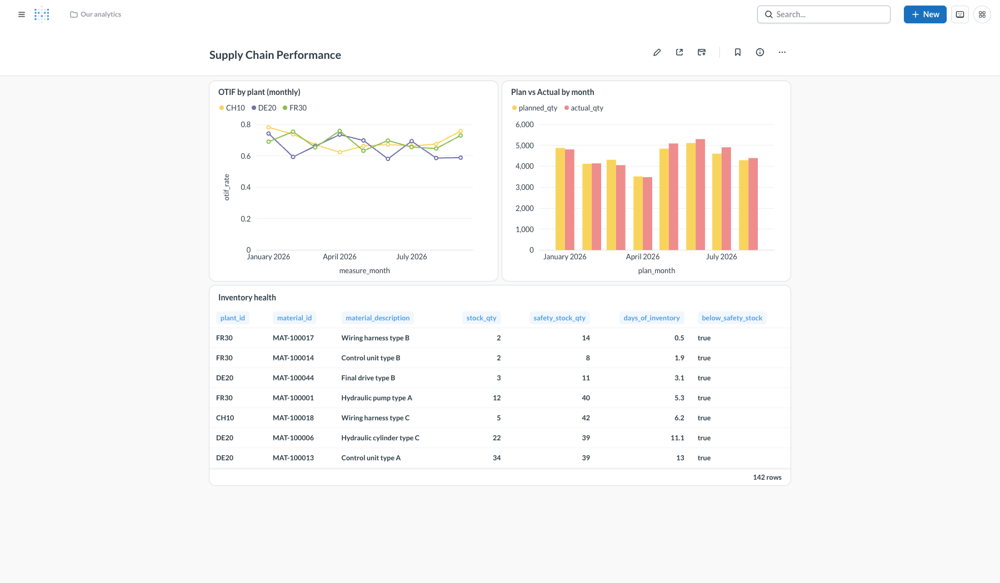 **Metabase dashboard** the business uses (OTIF, Plan vs Actual, inventory health) | 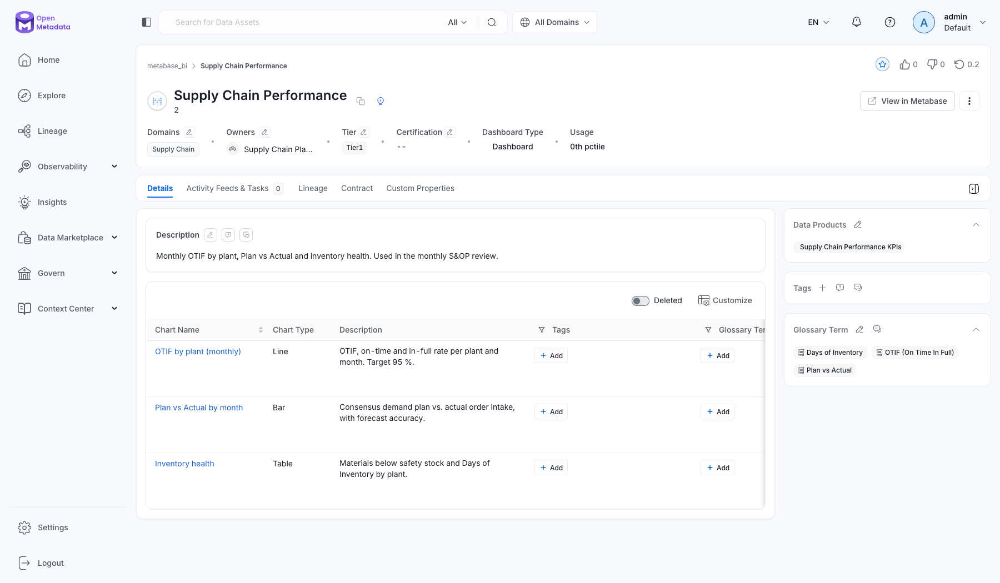 **The same dashboard in the catalogue** with owner, domain, Tier and glossary terms |
| 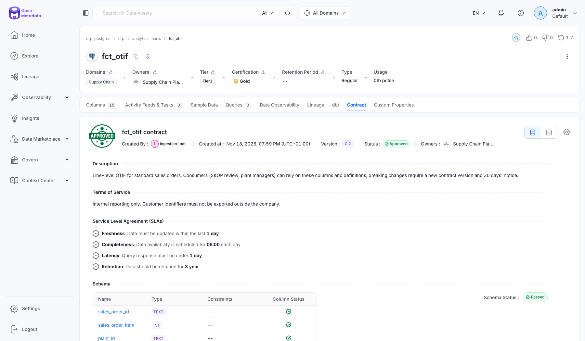 **Data contract** on the OTIF fact table: SLA, terms, guaranteed schema | 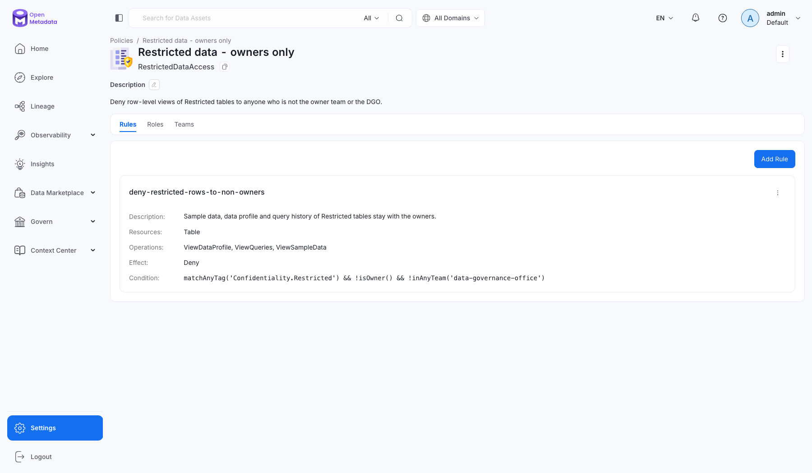 **Access policy**: Restricted rows only for owners and the DGO |
| 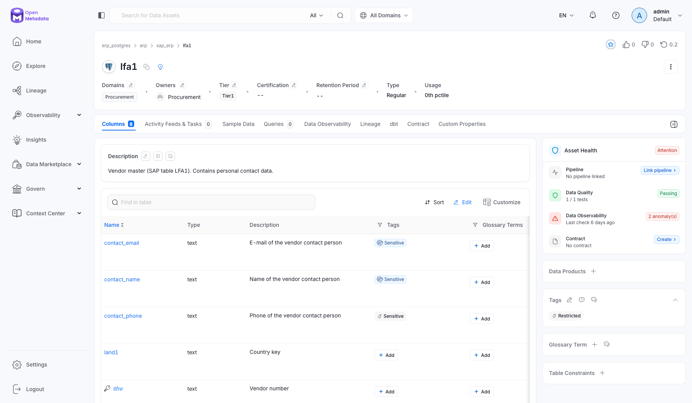 **Vendor master** with owner, domain, Tier, `Restricted` label and PII tags |  **Supply Chain Glossary**: 13 approved terms |
|  **OTIF** definition, synonyms, related terms, owner and reviewer |  **Certified Gold** KPI table linked to the OTIF term |
|  **Data quality** across raw and transformed layers | 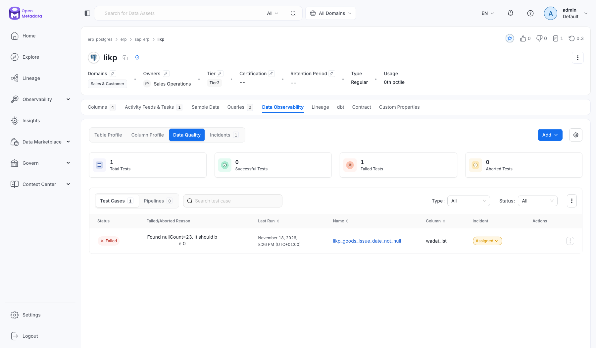 A failing test opens an **incident** for the owner |
|  **Lineage** from the SAP tables to the OTIF fact | 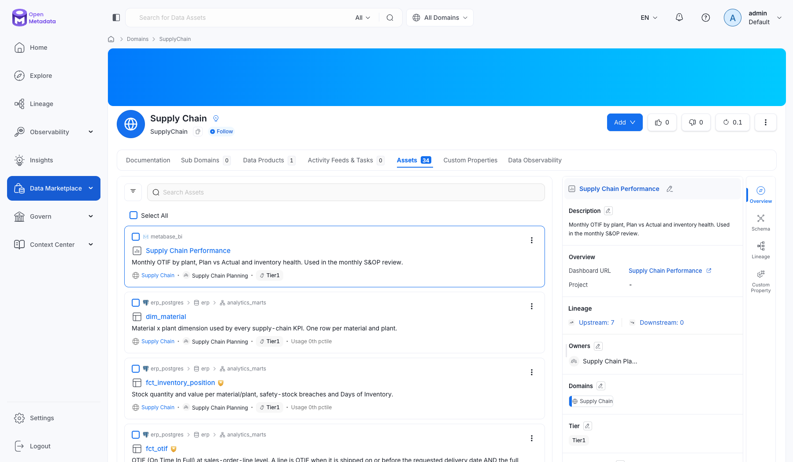 **Supply Chain domain** and its assets |
| 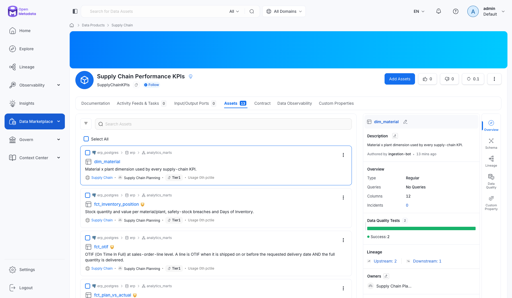 **Data product** for the certified KPIs | 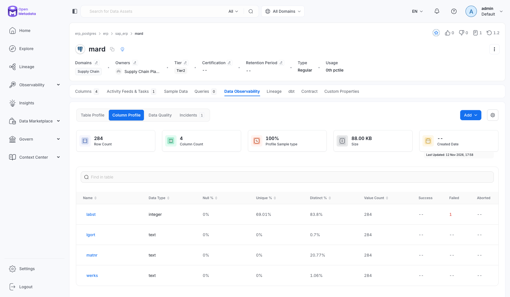 **Column profile**: nulls, distinct values, min/max |

## Design decisions

- **Data minimisation by design.** Personal contact data stays in the raw layer; the dbt staging
  models for customers and vendors do not select it, so the analytics layer is PII-free and lineage proves it.
- **Find everything, open only what you own.** The access policy hides the rows of Restricted tables,
  never their existence, so people do not build shadow copies.
- **Automation proposes, stewards decide.** Auto-classification is useful but imperfect (1 miss and
  4 false positives here); the review step is written down as code and repeated on every run.
- **Contracts for what consumers depend on.** Only certified tables get contracts, and CI refuses a
  certification without one.
- **Plausibility tests, not only validity tests.** A real integer-division bug pushed forecast accuracy
  to 97 %. Every range test passed; the BI dashboard exposed it. A dedicated test now guards it
  (see the operating model, section 7).
- **Governance as code, measured.** Ownership, glossary, contracts and policies go through pull requests;
  adoption KPIs are computed from the API, not typed into a slide.
- **Laptop-friendly.** The ERP and Metabase databases share the Postgres container with OpenMetadata's
  own store; the full stack uses about 6 GB of RAM.

## Notes

- OpenMetadata quirks found on the way: range tests (`columnValuesToBeBetween`) are rejected on Postgres
  `NUMERIC` columns without precision; contract SLA timezones accept only a fixed list; creating users
  needs an admin principal (the ingestion bot is not one); and contract validation must wait until
  Airflow has loaded the quality pipeline deployed on save.
- With Power BI or Tableau, the native OpenMetadata connector would replace the Metabase step; the
  governance model does not change.
- Credentials in this repository are local demo defaults; nothing is exposed outside `localhost`.
