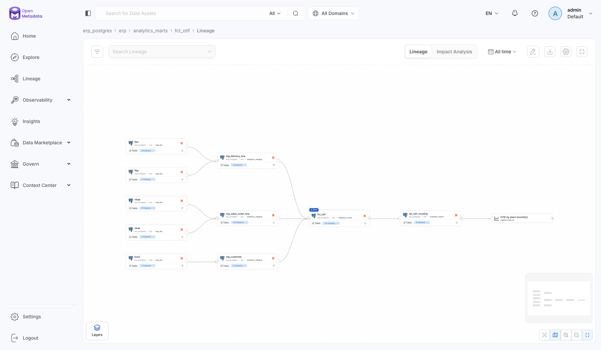
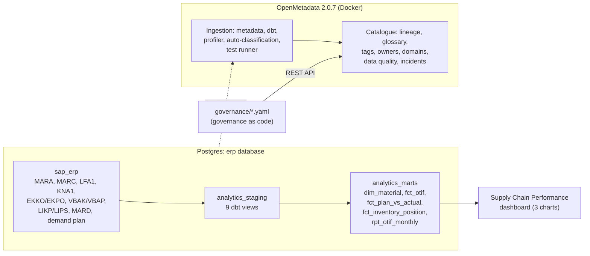
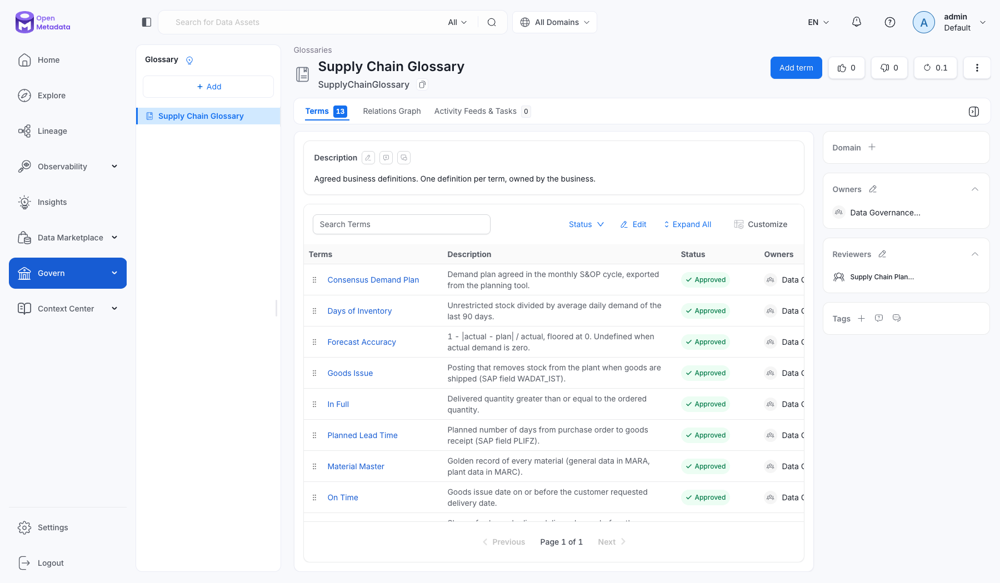
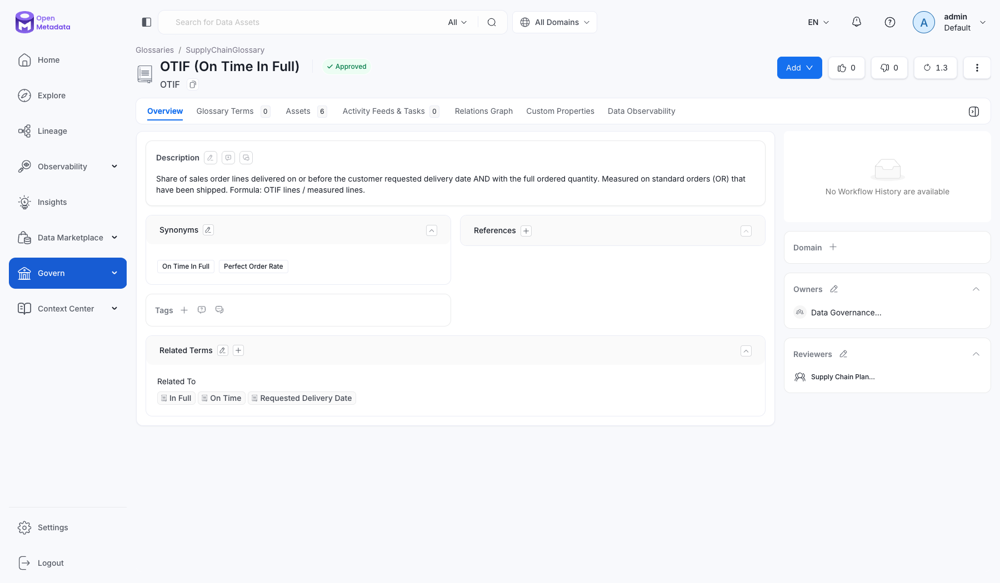
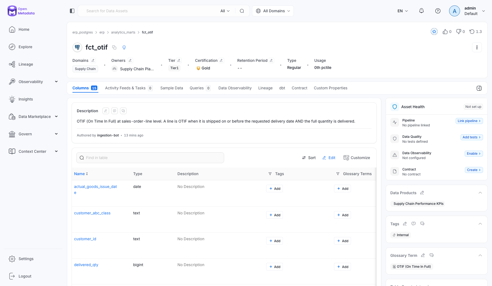
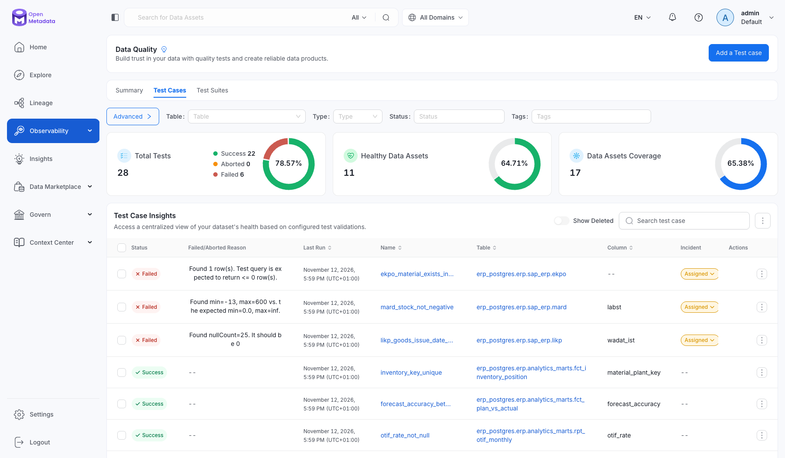

# Supply Chain Data Catalogue & Governance with OpenMetadata

A hands-on, reproducible data-governance setup for a manufacturing supply chain running on an
SAP-style ERP: **metadata ingestion, end-to-end lineage, PII classification, business glossary,
data-quality tests, certification and a documented operating model**, all built on
[OpenMetadata](https://open-metadata.org) 2.0.7 and kept as code.

> All data is synthetic (fixed random seed). Table names follow SAP ECC conventions
> (MARA, MARC, LFA1, KNA1, EKKO/EKPO, VBAK/VBAP, LIKP/LIPS, MARD) so the catalogue looks like
> a real ERP landscape.


*Lineage from the SAP tables (left) through dbt staging models to the certified OTIF fact table,
the monthly report and the dashboard chart (right).*

## What it demonstrates

| Capability | How it is done here | Result |
|---|---|---|
| **Metadata ingestion** | OpenMetadata Postgres connector on the ERP schema + dbt artifacts | 26 tables with descriptions from SAP comments and dbt docs |
| **Lineage** | View SQL parsing + dbt manifest + dashboard registered via API | ERP table → staging → mart → report → chart → dashboard |
| **Classification** | Auto-classification (PII detection) + steward review in YAML | 5 personal-data columns tagged `PII.Sensitive`; Confidentiality labels on every governed table |
| **Business glossary** | 13 approved terms (OTIF, Plan vs Actual, Days of Inventory, Safety Stock…) with synonyms, related terms, owner and reviewer | Terms linked to the exact column that computes the KPI |
| **Data quality** | OpenMetadata test runner on raw tables + dbt test results ingested | 28 tests, 22 pass, 6 fail = the 3 defects injected on purpose, caught at both layers; failures open incidents |
| **Ownership & domains** | 4 teams, 3 domains, 1 data product, Tier and Gold certification | 17 governed tables, 4 certified KPI tables |
| **Operating model** | [docs/GOVERNANCE_MODEL.md](docs/GOVERNANCE_MODEL.md) | RACI, classification policy, certification criteria, domain onboarding, adoption KPIs |

## Architecture



## Repository layout

```
data/          synthetic SAP-style data generator + database init
dbt/           staging and mart models (OTIF, Plan vs Actual, inventory) with tests
ingestion/     OpenMetadata workflow configs: metadata, dbt, profiler, auto-classification
governance/    governance.yaml (teams, domains, glossary, tags, owners, certification, dashboard)
               data_quality.yaml (quality contract with a business rationale per test)
scripts/       apply_governance.py, data_quality.py, run_ingestion.sh, screenshots.py
docs/          GOVERNANCE_MODEL.md and screenshots
docker/        OpenMetadata docker-compose (ports bound to localhost, no auto-restart)
```

## Run it

Requirements: Docker Desktop with ~6 GB of memory, [uv](https://docs.astral.sh/uv/), ~8 GB of disk.

```bash
make up        # OpenMetadata on http://localhost:8585 (admin@open-metadata.org / admin, local only)
make init-db   # creates the demo "erp" database and a read-only user for the catalogue
make all       # data -> dbt -> ingestion -> governance -> data-quality tests (about 3 minutes)
make down      # stop everything
```

Every step is idempotent: change `governance/governance.yaml`, run `make governance`, and the
catalogue converges to the file.

## Screenshots

| | |
|---|---|
|  **Vendor master** with owner, domain, Tier, `Restricted` label and PII tags |  **Supply Chain Glossary**: 13 approved terms |
|  **OTIF** definition, synonyms, related terms, owner and reviewer |  **Certified Gold** KPI table linked to the OTIF term |
|  **Data quality**: 28 tests across raw and transformed layers |  A failing test opens an **incident** for the owner |
|  **Supply Chain domain** and its assets |  **Data product** for the certified KPIs |
|  **Dashboard** registered with charts, owner and Tier |  **Column profile**: nulls, distinct values, min/max |

## Design decisions

- **Data minimisation by design.** Personal contact data stays in the raw layer; the dbt staging
  models for customers and vendors do not select it, so the analytics layer is PII-free and lineage proves it.
- **Two quality layers.** Source tests catch ERP posting errors where they happen (owned by the
  business); dbt tests protect the transformations (owned by the data team).
- **Automation proposes, stewards decide.** Auto-classification found 4 of 5 personal columns; the
  fifth (`contact_phone`) is added in YAML. The review step is part of the process, not a workaround.
- **Governance as code.** Ownership, glossary and certification go through pull requests, which
  gives an audit trail and lets the catalogue be rebuilt from scratch.
- **Laptop-friendly.** The ERP database shares the Postgres container with OpenMetadata's own store;
  the full stack uses about 4–5 GB of RAM.

## Notes

- The BI layer is registered through OpenMetadata's API as a custom dashboard service, so the
  lineage reaches the dashboard without installing a BI tool. With Power BI, Tableau or Superset
  the native connector would replace that step.
- One OpenMetadata quirk found on the way: range tests (`columnValuesToBeBetween`) are rejected on
  Postgres `NUMERIC` columns without precision, so quantities are typed as integers and ratios as
  `double precision`.
- Credentials in this repository are local demo defaults; nothing is exposed outside `localhost`.
