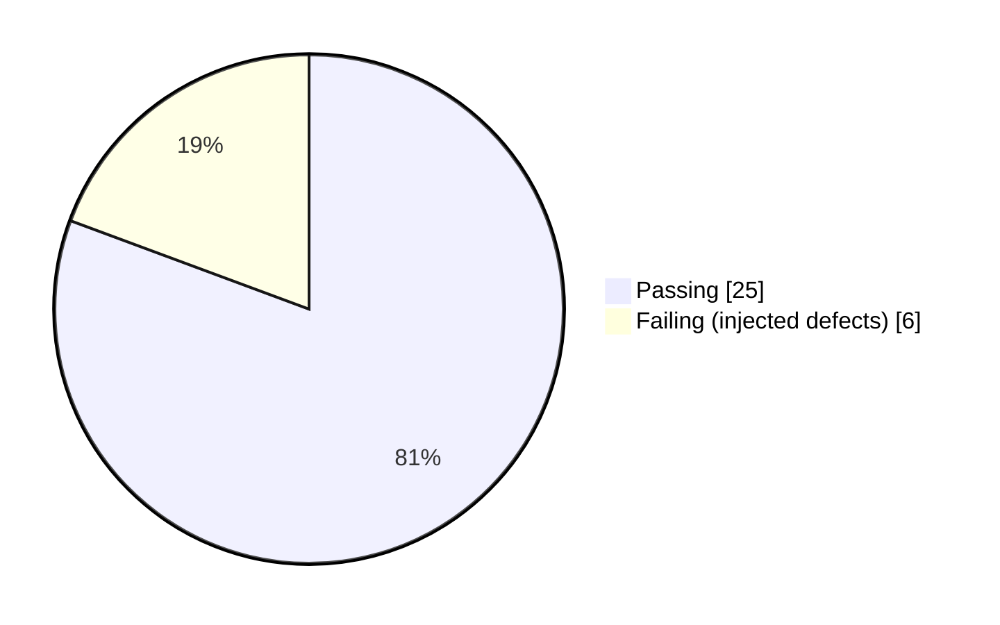

# Governance Scorecard

*Generated by `scripts/scorecard.py` from the live OpenMetadata API on 18 November 2026.*
*Scope: 26 tables in `erp_postgres.erp`, of which 17 governed and 9 Tier 1.*

| Area | KPI | Value | Detail | Target |
|---|---|---|---|---|
| Ownership | Tier 1 tables with an owner team | **100 %** | 9/9 | 100 % |
| Ownership | Tier 1 tables with a domain | **100 %** | 9/9 | 100 % |
| Documentation | Tier 1 tables with a description | **100 %** | 9/9 | 100 % |
| Documentation | Approved glossary terms | **100 %** | 13/13 | 100 % |
| Documentation | Columns linked to a glossary term | **11** |  |  |
| Classification | Columns tagged as sensitive personal data (PII.Sensitive) | **5** |  |  |
| Quality | Tables with data-quality tests | **69 %** | 18/26 | ≥ 60 % |
| Quality | Tests passing | **81 %** | 25/31 | ≥ 95 % |
| Quality | Open data-quality incidents | **6** |  | 0 older than 10 days |
| Trust | Certified (Gold) tables | **4** | fct_inventory_position, fct_otif, fct_plan_vs_actual, rpt_otif_monthly |  |
| Trust | Data contracts passing validation | **100 %** | 4/4 | 100 % |
| Lineage | Table-level lineage edges | **41** |  |  |
| Lineage | Column-level lineage mappings | **182** |  |  |

## Data-quality results

The failing tests are expected: the synthetic data contains three deliberate defects
(deliveries without goods-issue date, negative stock, a purchase order for an unknown material),
each caught at the raw layer by OpenMetadata and at the staging layer by dbt.
